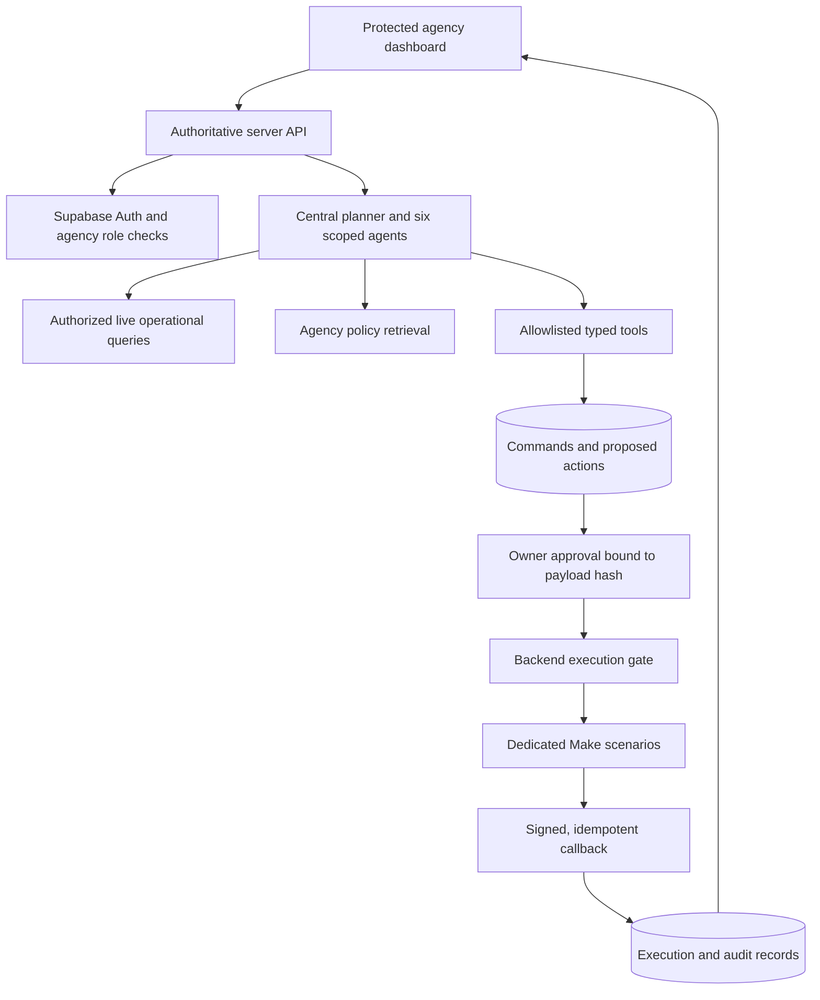

# AI Command Center Architecture

## Target architecture

The dashboard must be an additional orchestration layer over existing agency features. Existing chatbot, ATS, operations, campaigns, and interview routes remain in place. During implementation, select either the Cloudflare Worker or Express service as the authoritative command API after confirming production deployment ownership; do not create competing orchestrators.

The Cloudflare Worker is selected for command planning because it serves the deployed dashboard and already has agency admin authentication, Workers AI, Supabase service-role access, and the RAG retrieval path. The Express service retains its Phase 3 approval and callback foundation; it does not plan commands.

The six agent definitions are static, server-side routing configurations. The planner validates each selected ID against the registry. The protected agent catalog reports planning-only status. Phase 7 adds one separately callable read-only policy knowledge tool; it does not connect operational records, write actions, or execution history.

Execution monitoring uses an authenticated Express server-sent event endpoint that reads minimal status rows under the owner’s agency scope. The browser does not subscribe to Supabase tables; Command Center tables remain service-role-only. The stream revalidates the owner session periodically and has a bounded lifetime.

## Data boundaries

- Live applicant, employer, campaign, interview, matching, arrival, and task facts come from their authorized source records.
- Initial vector retrieval is limited to approved agency policies and procedures. Personal operational records are not copied into a global vector index.
- Tools are explicit allowlisted server functions. Model output can propose a call but cannot authorize access or execution.
- Sensitive operations are stored as proposed actions, reviewed against the exact payload hash, and reauthorized at the execution gateway.
- Make is a third-party execution layer. A webhook response is not evidence of message delivery; per-recipient results and authenticated callbacks are required.

## Command lifecycle

Commands/actions use the states `draft`, `planning`, `awaiting_approval`, `approved`, `rejected`, `queued`, `running`, `succeeded`, `partially_succeeded`, `failed`, `cancelled`, and `expired`. Execution rows additionally support `unknown` to represent an uncertain provider outcome. The backend must implement legal transitions and reconcile `unknown` executions before any retry.

## Phase 2 schema decisions

The additive migration `supabase/20261120_ai_command_center_foundation.sql` introduces command/action/approval/execution records, a disabled-by-default tool registry, and ingestion job tracking. It does not recreate `ai_conversations`, `ai_messages`, or legacy `ai_agent_*` tables because the repository references these but does not include their actual DDL. Existing `ai_sessions`, `ai_actions`, knowledge tables, campaign tables, and outbox remain untouched. All new tables are service-role-only until dedicated read APIs and a reviewed RLS policy are implemented.

This is a proposed migration artifact. It has not been applied to Supabase; confirm the live schema before application.
